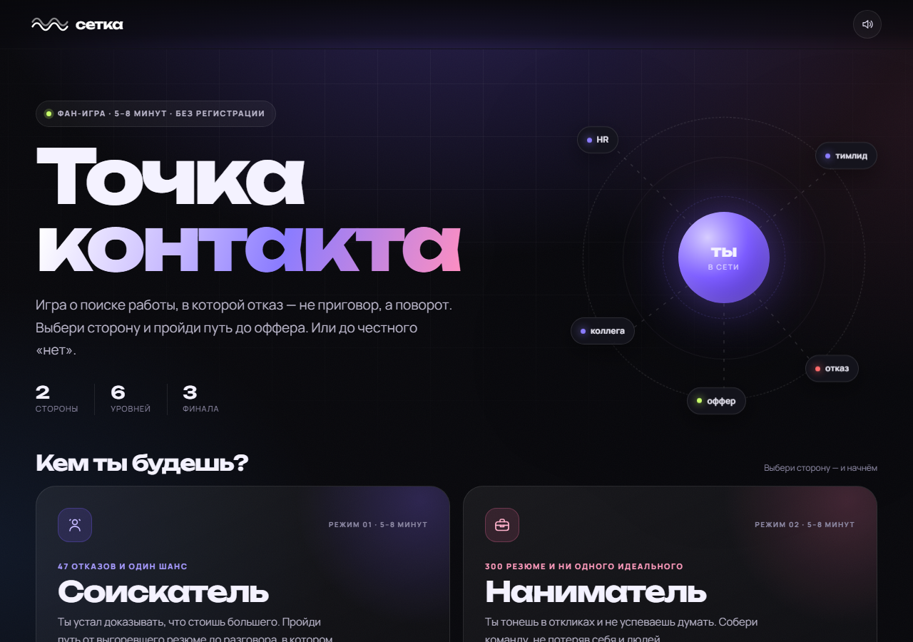

# Точка контакта

Браузерная игра о поиске работы и людях — с двух сторон стола.

Соискатель устал от отказов, наниматель тонет в резюме. Одна история, две оптики и три финала: оффер, компромисс или честное «нет». В конце — разбор решений и ссылка на резюме автора.

**Играть:** откройте `index.html` или опубликуйте папку на GitHub Pages.



## Что внутри

- Два режима: **Соискатель** и **Наниматель**.
- По шесть уровней в каждом: резюме, нетворкинг, собеседование, переговоры, оффер и выход на новую работу.
- Три финала для каждой стороны — результат зависит от решений, а не от одного «правильного» ответа.
- Две мини-игры: сборка резюме из блоков и сортировка откликов.
- Показатели, которые меняются от выбора к выбору.
- Сохранение прогресса в `localStorage`, продолжение с того же уровня.
- Звук на WebAudio с возможностью отключить, конфетти и кнопка «Поделиться результатом».
- Адаптивная вёрстка, поддержка клавиатуры и `prefers-reduced-motion`.

## Управление

- Мышь или палец — выбор вариантов и кнопки.
- Клавиши **1–4** — быстрый выбор ответа в диалогах.
- **Esc** — закрыть диалог подтверждения.
- Кнопка с динамиком в шапке — включить или выключить звук.

Прогресс сохраняется автоматически. Если вернуться на главную, незаконченный путь можно продолжить по кнопке «Продолжить путь». При запуске новой игры поверх сохранения появится подтверждение.

## Локальный запуск

Игра не требует сборки и зависимостей — это один статический файл.

Можно просто открыть `index.html` в браузере. Для проверки «как на хостинге» удобнее поднять локальный сервер:

```bash
python -m http.server 8000
```

Затем открыть <http://localhost:8000/>.

## Публикация на GitHub Pages

1. Создайте репозиторий на GitHub.
2. Положите в корень репозитория `index.html` и `.nojekyll`.
3. Откройте **Settings → Pages**.
4. В разделе **Build and deployment** выберите **Deploy from a branch**.
5. Укажите ветку `main` и папку `/ (root)`, сохраните.
6. Через минуту страница будет доступна по адресу `https://<username>.github.io/<repo>/`.

Если сайт должен жить в отдельном репозитории `username.github.io`, просто положите файлы в его корень.

`.nojekyll` отключает обработку файлов через Jekyll — для одностраничной статики это лишняя страховка.

## Структура

```text
.
├── index.html   # вся игра: разметка, стили и логика
├── preview.png  # превью для README
└── .nojekyll    # отключение Jekyll на GitHub Pages
```

`index.html` намеренно собран как single-file build: стили и скрипт встроены, внешних JS-зависимостей нет. Из сети подгружаются только шрифты Google Fonts; при их недоступности используются системные.

## Технические заметки

- Прогресс: `setka.contact.save.v1`
- Лучшие результаты и достижения: `setka.contact.meta.v1`
- Настройка звука: `setka.contact.sound`
- Оценка пути складывается из качества решений и среднего значения показателей; финал выбирается по порогам, а не по одному ответу.
- Игра не отправляет данные на сервер: всё хранится локально в браузере.

## Дисклеймер

Фан-игра по мотивам Сетки. Не официальный продукт hh.ru и не связана с hh.ru или Setka.

## Автор

**Булат Хайрльварин** — Senior Graphic Designer, 10 лет опыта.

Резюме и портфолио: <https://bullez.github.io/designer/>
